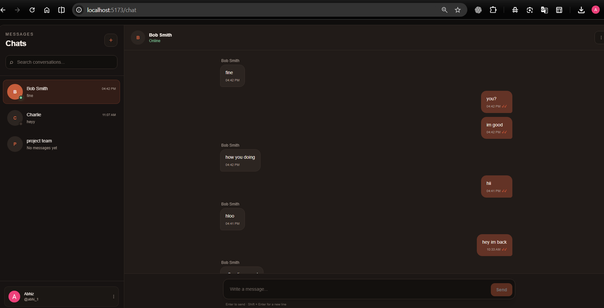

# ChatX

**A real-time messaging application built to explore backend engineering, in-depth authentication, and real-time communication using Socket.IO.**

## Summary

ChatX is a full-stack real-time messaging application developed with a strong focus on backend engineering rather than simply building a chat interface. It combines a structured REST API, secure authentication, MongoDB data management, and Socket.IO to support real-time communication.

### Why I Chose ChatX

I chose ChatX as a practical project to understand how production-level backend systems are designed and implemented. My main objective was to explore authentication in depth, build and manage a large set of REST API routes, understand backend architecture, and implement real-time communication using Socket.IO.

Instead of limiting the project to basic login, registration, and messaging, I wanted to work through authentication flows, session management, security, database relationships, API design, and real-time events in a single application.

### HomePage

## Key Features

- User registration and login with password hashing.
- Email verification using OTP.
- Forgot password, OTP verification, and password reset.
- JWT access and refresh token authentication.
- Session management, logout, and logout from all devices.
- Google OAuth 2.0 authentication.
- Protected REST APIs with authentication and validation middleware.
- Direct and group conversations.
- Message creation, editing, deletion, and history retrieval.
- Conversation member and role management.
- User and conversation search.
- Real-time messaging using Socket.IO.
- Online/offline presence and typing indicators.
- Message delivery and read receipts.
- Profile management.

## MVP Status

**MVP development: Phases 0–3 implemented.**

### Phase 0 — Project Setup and Architecture

Established the frontend and backend structure, configured the development environment, connected MongoDB, and set up the core application architecture.

### Phase 1 — Authentication and Security

Implemented registration, login, email verification, password recovery, JWT access and refresh tokens, session management, Google OAuth, protected routes, and authentication middleware.

### Phase 2 — REST API and Database

Built the REST API for users, profiles, conversations, members, and messages. Designed MongoDB models and relationships, implemented CRUD operations, validation, and search functionality.

### Phase 3 — Real-Time Communication

Integrated Socket.IO with authenticated connections, real-time messaging, typing indicators, online/offline presence, delivery and read receipts, and conversation-based communication.

## Tech Stack

| Category | Technologies |
|---|---|
| Frontend | React 19, Vite |
| State Management | Redux Toolkit, React Redux |
| Routing | React Router |
| Styling | Tailwind CSS 4 |
| Backend | Node.js, Express 5 |
| Database | MongoDB, Mongoose |
| Real-Time Communication | Socket.IO |
| Authentication | JWT, bcryptjs, Passport.js |
| OAuth | Google OAuth 2.0 |
| Validation | Joi |
| Security | Helmet, CORS, Express Rate Limit |
| Email | Nodemailer |
| Development Tools | Nodemon, ESLint |

## Installation and Local Development

### Prerequisites

- Node.js and npm
- MongoDB instance
- Google OAuth credentials (for Google login)
- Email account or SMTP credentials (for email features)

### 1. Clone the repository

```bash
git clone <repository-url>
cd realtime-chat-app
```

### 2. Backend setup

```bash
cd backend
npm install
```

Create a `.env` file inside the backend directory and configure the required environment variables:

| Variable | Purpose |
|---|---|
| `PORT` | Backend server port |
| `MONGO_URI` | MongoDB connection string |
| `CLIENT_URL` | Frontend application URL |
| `JWT_ACCESS_SECRET` | Access token signing secret |
| `JWT_REFRESH_SECRET` | Refresh token signing secret |
| `ACCESS_TOKEN_EXPIRES_IN` | Access token expiry |
| `REFRESH_TOKEN_EXPIRES_IN` | Refresh token expiry |
| `GOOGLE_CLIENT_ID` | Google OAuth client ID |
| `GOOGLE_CLIENT_SECRET` | Google OAuth client secret |
| `GOOGLE_CALLBACK_URL` | Google OAuth callback URL |
| `EMAIL_USER` | Email account used for sending emails |
| `EMAIL_PASS` | Email or SMTP credential |
| `EMAIL_FROM` | Sender email address |

Start the backend:

```bash
npm run dev
```

The backend runs on `http://localhost:5000` by default.

### 3. Frontend setup

Open a separate terminal:

```bash
cd frontend
npm install
```

Configure the frontend API URL using `VITE_API_URL` in the frontend environment file.

Start the frontend:

```bash
npm run dev
```

### 4. Production build

```bash
npm run build
```

Run the frontend lint check:

```bash
npm run lint
```

## API Documentation

ChatX currently implements **40 HTTP endpoints**: 39 application routes across six route groups and one health-check endpoint.

The route tables below reflect the backend route registrations.

### Authentication — `/auth` (18 routes)

| Method | Endpoint | Purpose |
|---|---|---|
| POST | `/auth/register` | Register a new user |
| POST | `/auth/verify-email` | Verify email using OTP |
| POST | `/auth/resend-verification-otp` | Resend email verification OTP |
| POST | `/auth/login` | Authenticate a user |
| POST | `/auth/refresh-token` | Refresh authentication tokens |
| POST | `/auth/logout` | Log out the current session |
| POST | `/auth/logout-all` | Log out all active sessions |
| GET | `/auth/me` | Get the authenticated user |
| POST | `/auth/forgot-password` | Start password recovery |
| POST | `/auth/verify-reset-otp` | Verify password reset OTP |
| POST | `/auth/resend-reset-otp` | Resend password reset OTP |
| POST | `/auth/reset-password` | Reset account password |
| POST | `/auth/change-password` | Change authenticated user's password |
| GET | `/auth/google` | Start Google OAuth authentication |
| GET | `/auth/google/callback` | Handle Google OAuth callback |
| GET | `/auth/google/failure` | Handle Google OAuth failure |
| GET | `/auth/sessions` | Get active user sessions |
| DELETE | `/auth/sessions/:id` | Revoke a specific session |

### Users — `/users` (3 routes)

| Method | Endpoint | Purpose |
|---|---|---|
| GET | `/users` | Get users |
| GET | `/users/:id` | Get a user by ID |
| PATCH | `/users/:id` | Update user information |

### Profile — `/profile` (2 routes)

| Method | Endpoint | Purpose |
|---|---|---|
| GET | `/profile` | Get authenticated user's profile |
| PATCH | `/profile` | Update authenticated user's profile |

### Conversations — `/conversations` (11 routes)

| Method | Endpoint | Purpose |
|---|---|---|
| GET | `/conversations` | Get user's conversations |
| POST | `/conversations` | Create a conversation |
| GET | `/conversations/:id` | Get conversation details |
| PATCH | `/conversations/:id` | Update conversation details |
| DELETE | `/conversations/:id` | Delete a conversation |
| GET | `/conversations/:id/messages` | Get conversation messages |
| POST | `/conversations/:id/messages` | Create a message |
| GET | `/conversations/:id/members` | Get conversation members |
| POST | `/conversations/:id/members` | Add a conversation member |
| DELETE | `/conversations/:id/members/:userId` | Remove a conversation member |
| PATCH | `/conversations/:id/members/:userId` | Update a member's role |

### Messages — `/messages` (3 routes)

| Method | Endpoint | Purpose |
|---|---|---|
| GET | `/messages/:id` | Get a message by ID |
| PATCH | `/messages/:id` | Update a message |
| DELETE | `/messages/:id` | Delete a message |

### Search — `/search` (2 routes)

| Method | Endpoint | Purpose |
|---|---|---|
| GET | `/search/users` | Search users |
| GET | `/search/conversations` | Search conversations |

### Health Check (1 route)

| Method | Endpoint | Purpose |
|---|---|---|
| GET | `/api/health` | Check API server status |

## Future Development

### Phase 4 — Media and File Sharing

Add image and document sharing, file validation, size limits, image previews, upload progress, and download functionality with media storage integration.

### Phase 5 — Advanced Reliability and Offline Synchronization

Improve offline message handling, reconnection recovery, retry mechanisms, and synchronization to make real-time communication more reliable across devices.

## License

This project is licensed under the [MIT License](LICENSE).